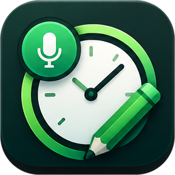
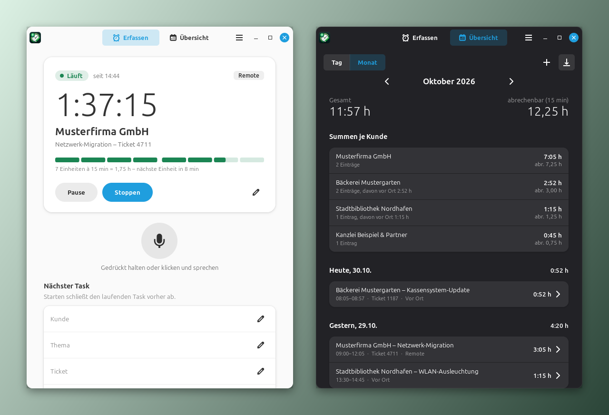
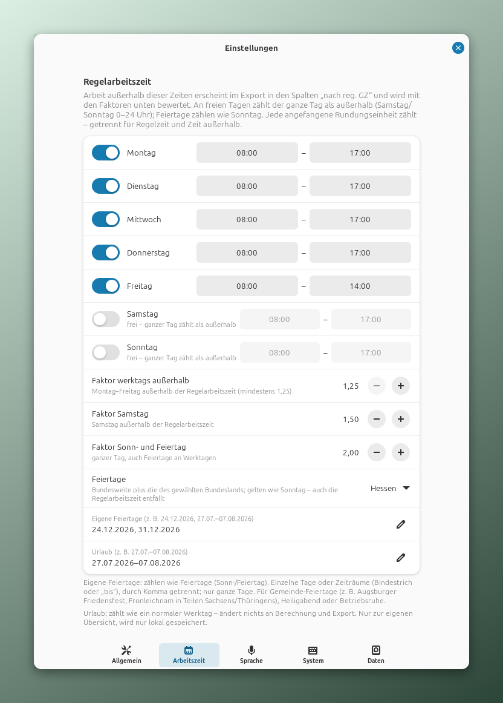

<p align="center">
  
</p>

<h1 align="center">Tracksy</h1>

<p align="center">
  Arbeitszeit erfassen per Klick, Tastenkürzel oder Sprache – komplett lokal, ohne Cloud.<br>
  Für Linux Mint (Cinnamon) und Ubuntu (GNOME).
</p>

<p align="center">
  
</p>

> [!WARNING]
> **Experimentell.** Tracksy ist eine frühe Testversion (0.12). Funktionen, Datenformat und Bedienung können sich noch ändern, und Fehler sind möglich. Bitte sichere deine Daten regelmäßig (`zeit backup`) und verlasse dich für abrechnungsrelevante Zeiten nicht allein auf diese Version.

## Was ist Tracksy?

Tracksy ist eine Desktop-App für alle, die ihre Arbeitszeit pro **Kunde, Thema und Ticket** festhalten und daraus Leistungsnachweise erstellen müssen – etwa Freelancer, IT-Dienstleister oder Support-Teams.

Die Zeit läuft im Hintergrund weiter, auch wenn das Fenster geschlossen ist. Starten, pausieren und stoppen geht gleichwertig über das Fenster, das Symbol in der Leiste, ein Tastenkürzel, die Kommandozeile oder per Sprache („Ich starte für Kunde Müller, Thema Backup, Ticket 1234“). Beim Stoppen fragt Tracksy kurz nach, ob du noch etwas ergänzen möchtest, und speichert erst dann.

Die erfassten Zeiten lassen sich als **Excel-Datei (XLSX)** oder **CSV** exportieren – je Kunde oder für alle Kunden, als Tätigkeitsbericht oder Monatsbericht, auf Wunsch in deiner eigenen Excel-Vorlage. Weil der Export auch über die Kommandozeile funktioniert (z. B. `zeit export --alle-kunden --monat 2026-10 --format csv`), lassen sich Berichte automatisiert erstellen – etwa monatlich per Cron-Job oder als Datenquelle für Buchhaltung, Tabellenkalkulation oder eigene Workflows.

Tracksy läuft derzeit unter Linux (siehe [Unterstützte Systeme](#unterstützte-systeme)). Unterstützung für weitere Betriebssysteme und Desktops kann folgen, wenn Interesse besteht – sag gern Bescheid, z. B. als Issue in diesem Repository.

## Funktionen

- **Zeiterfassung** – Start, Pause/Weiter, Stopp; Anzeige der laufenden Zeit und der abrechenbaren 15-Minuten-Einheiten
- **Sprachsteuerung (offline)** – Push-to-talk mit [whisper.cpp](https://github.com/ggml-org/whisper.cpp), Deutsch; unklare Befehle werden nachgefragt, nie geraten
- **Ergänzungsdialog beim Stoppen** – Freitext und weitere erledigte Tätigkeiten, auch per Diktat
- **Absturzsicher** – jede Änderung wird sofort gespeichert; ein laufender Task wird nach einem Absturz wieder aufgenommen, die Ausfallzeit wird nachgefragt
- **Ruhezustand** – nach Standby oder Ruhezustand fragt Tracksy, ob die Zeit dazwischen abgezogen werden soll
- **Übersicht** – Tages- und Monatsansicht mit Summen je Kunde, Einträge nachträglich bearbeiten oder manuell anlegen (jede Änderung wird protokolliert)
- **Export** – Leistungsnachweis je Kunde oder für alle Kunden, als Monatsbericht (Tage zusammengefasst) oder Tätigkeitsbericht, als XLSX (eigenes Layout oder eigene Vorlage) und CSV; Aufrunden (z. B. 15 Minuten, jede angefangene Einheit zählt, getrennt für Regelzeit und Zeit außerhalb) nur im Export, die Rohzeiten bleiben erhalten
- **Regelarbeitszeit und Zuschläge** – Regelarbeitszeit je Wochentag; Arbeit außerhalb wird im Export getrennt ausgewiesen (Beginn, Ende, Stunden) und gewichtet: werktags außerhalb der Regelzeit mindestens ×1,25, Samstag ×1,5, Sonn- und Feiertag ×2 (Faktoren einstellbar). Gesetzliche Feiertage (bundesweit plus gewähltes Bundesland) werden lokal berechnet, eigene Feiertage und Urlaub lassen sich als Tage oder Zeiträume eintragen ([mehr dazu](#regelarbeitszeit-und-zuschläge))
- **Datenpflege** – Sicherung, Aufbewahrungsfrist und gezieltes Löschen (DSGVO-Löschkonzept)
- **Hell und dunkel** – wie im System oder fest hell/dunkel (Einstellungen → Allgemein → Darstellung), vollständig per Tastatur bedienbar; eigene Farbpalette, auf allen Desktops gleich

## Datenschutz

- **Alles bleibt auf deinem Rechner.** Keine Cloud, keine Konten, keine Telemetrie. Es werden nur Open-Source-Komponenten verwendet.
- **Spracheingabe vorbereiten:** Kurz nach dem Start lädt Tracksy die Audio-Bibliothek und fragt dabei die Audiogeräte ab – es wird nichts aufgenommen. Das macht die erste Aufnahme schneller und lässt sich unter Einstellungen → Sprache abschalten.
- **Audio wird nie gespeichert** – weder als Datei noch in Logs oder Absturzabbildern. Es wird nur im Arbeitsspeicher verarbeitet und danach verworfen. Lässt sich der Schutz vor Absturzabbildern nicht einschalten, startet die Aufnahme gar nicht. Das Mikrofon ist nur aktiv, solange du die Sprachtaste benutzt.
- **Systembenachrichtigungen ohne Inhalte:** Ist kein Tracksy-Fenster sichtbar, erscheinen Rückmeldungen als Systembenachrichtigung – nur mit neutralem Text (z. B. „Task gestartet“), ohne Kunden, Themen oder erkannten Sprachtext, weil der Desktop Benachrichtigungen im Verlauf speichert.
- **Internetverbindungen – vollständige Liste:** Die App selbst baut genau eine Verbindung auf, und auch die nur nach deiner Zustimmung (Sprachmodell, siehe unten). Dazu kommen Downloads, die **du** auslöst: das Git-Repository selbst (`git clone` und Updates, github.com) und die Python-Bibliotheken bei Installation und Update (siehe [Was bei der Installation heruntergeladen wird](#was-bei-der-installation-heruntergeladen-wird)). Zeiterfassungs-, Kunden- oder Audiodaten werden dabei nie übertragen.
- **Sprachmodell:** einmaliger Download von `huggingface.co` – nur nach deiner Zustimmung. Übertragen werden dabei nur die technisch nötigen Verbindungsdaten (IP-Adresse, Datei-URL, Programmkennung). Das Modell wird anhand von Größe und zwei Prüfsummen (SHA-1, SHA-256) geprüft. Hugging Face leitet dabei auf sein Auslieferungsnetz (`*.hf.co`) weiter; andere Ziele lehnt Tracksy ab. Die Server stehen in den USA. Ein abgebrochener Download hinterlässt keine Reste; ein beschädigtes Modell lässt sich unter Einstellungen → Sprache erneut herunterladen (die alte Datei wird archiviert, nicht gelöscht).
- **Updates nur auf deinen Aufruf:** `scripts/tracksy-update.sh` kontaktiert das Git-Repository (github.com, GitHub Inc./Microsoft, USA; übertragen werden IP-Adresse und Git-Protokolldaten) und danach ggf. PyPI. Die App selbst prüft nie auf Updates. Ohne Git-Zugriff: neuen Stand selbst in den Klon kopieren und `--no-pull` verwenden – PyPI wird dabei trotzdem angefragt; ein Update ganz ohne Internet ist derzeit nicht möglich.
- Die Daten liegen geschützt (nur für dein Benutzerkonto lesbar) unter `~/.local/share/zeiterfassung`. Sie enthalten personenbezogene Daten (dein Name, Kundenbezüge, Arbeitszeiten).

**Empfehlung:** Linux speichert bei einem Programmabsturz über systemd-coredump den Arbeitsspeicher des Programms auf der Festplatte. Tracksy schließt sich davon selbst aus. Zusätzlich kannst du Absturzabbilder systemweit abschalten (gilt für alle Programme):

```bash
sudo mkdir -p /etc/systemd/coredump.conf.d
printf '[Coredump]\nStorage=none\n' | sudo tee /etc/systemd/coredump.conf.d/90-keine-abbilder.conf
```

**Unter Ubuntu** übernimmt nicht systemd-coredump, sondern **apport** die Absturzberichte (in `/var/crash`). Der Schutz von Tracksy greift auch dort: Speicherbereiche (u. a. Audio-Puffer) sind vom Absturzabbild ausgeschlossen (unter Ubuntu noch nicht praktisch geprüft). Wer apport ganz abschalten möchte (gilt für alle Programme):

```bash
sudo systemctl disable --now apport.service
```

Ebenfalls empfohlen: Festplattenverschlüsselung bzw. verschlüsselter Swap.

## Unterstützte Systeme

| System | Status |
|---|---|
| **Linux Mint 22.x** (Cinnamon, X11) | getestet (Entwicklungssystem) |
| **Ubuntu 24.04 LTS** (GNOME, Wayland) | erwartet lauffähig – gleiche Paketbasis wie Mint 22; noch nicht auf echtem Ubuntu getestet |
| **Ubuntu 26.04 LTS** (GNOME 50, nur Wayland, Python 3.14) | erwartet lauffähig – alle benötigten Pakete vorhanden; noch nicht getestet |
| Ubuntu 22.04 und älter | nicht unterstützt (Python 3.10, libadwaita 1.1 zu alt) |

Unter GNOME braucht das Leistensymbol die AppIndicator-Erweiterung – Ubuntu liefert sie vorinstalliert mit, bei anderen GNOME-Systemen ggf. nachrüsten. Es zeigt nur das Symbol, nicht die laufende Zeit; die Zeit steht im Fenster und im Menü des Symbols. Rückmeldungen zu Ubuntu sind sehr willkommen.

## Voraussetzungen

- Linux Mint 22.x oder Ubuntu 24.04/26.04 (siehe oben)
- Python ≥ 3.12 (das System-Python wird verwendet)
- Ein Mikrofon ist optional. Ohne Mikrofon oder Sprachmodell funktioniert alles andere ganz normal.

> [!IMPORTANT]
> **Systempakete musst du vorher selbst installieren.** Das Installationsskript arbeitet ohne Administratorrechte und installiert deshalb **keine** Systempakete. Es prüft aber, ob alle vorhanden sind, und bricht bei fehlenden Paketen mit dem passenden `sudo apt install …`-Befehl ab. Diesen Befehl ausführen und das Skript danach einfach erneut starten.

Benötigte Systempakete (einmalig, mit Administratorpasswort):

```bash
sudo apt update
sudo apt install git gir1.2-gtk-4.0 gir1.2-adw-1 python3-gi python3-venv gir1.2-ayatanaappindicator3-0.1 libportaudio2
sudo apt install cmake g++    # nur für die Spracherkennung (wird beim Installieren kompiliert)
```

Ohne `cmake` und `g++` lässt sich Tracksy auch ohne Spracherkennung installieren (`--no-voice`, siehe unten).

## Installation

Die Installation erfolgt pro Benutzer in deinem Home-Verzeichnis, ohne Administratorrechte. Alle Befehle werden in einem **Terminal** eingegeben (Linux Mint: Menü → „Terminal“, oder `Strg+Alt+T`).

**1. Repository herunterladen** (legt den Ordner `tracksy` im aktuellen Verzeichnis an, z. B. in deinem Home-Verzeichnis):

```bash
cd ~
git clone https://github.com/DaAutimato/tracksy.git tracksy
```

**2. In den Ordner wechseln:**

```bash
cd ~/tracksy
```

**3. Installationsskript starten** (aus dem Ordner `tracksy` heraus):

```bash
./scripts/install.sh
```

Falls die Meldung `Keine Berechtigung` / `Permission denied` erscheint (z. B. weil die Dateien als ZIP statt per `git clone` geladen wurden), stattdessen `bash scripts/install.sh` verwenden.

Nützliche Optionen (lassen sich kombinieren):

| Option | Wirkung |
|---|---|
| `--dry-run` | nur anzeigen, was passieren würde – nichts wird verändert |
| `--autostart` | Tracksy beim Anmelden automatisch im Hintergrund starten |
| `--no-voice` | ohne Spracherkennung installieren (kein `cmake`/`g++` nötig) |
| `--python PFAD` | anderes Python ≥ 3.12 verwenden |

Beispiel: `./scripts/install.sh --autostart`

**4. Was das Skript macht:**
- prüft die Systempakete (nennt fehlende mit fertigem `apt`-Befehl und bricht ab, installiert selbst aber nichts),
- legt eine eigene Python-Umgebung unter `~/.local/share/zeiterfassung/venv` an und **lädt dafür Python-Bibliotheken aus dem Internet (PyPI)** – Details direkt unten,
- kompiliert die mitgelieferte Spracherkennung (whisper.cpp) für deinen Prozessor – ganz ohne Internet, dauert einige Minuten,
- legt die Befehle `zeit`, `zeit-tray` und `zeiterfassung` in `~/.local/bin`, einen Starter „Tracksy“ im Anwendungsmenü und optional einen Autostart an.

Am Ende erscheint `Fertig.` Danach Tracksy über das Anwendungsmenü starten. Das Sprachmodell wird nicht bei der Installation geladen, sondern erst beim ersten Start – und nur nach deiner Zustimmung.

### Was bei der Installation heruntergeladen wird

Ehrlich und vollständig: Die Installation ist **nicht** offline. Für die eigene Python-Umgebung lädt `pip` diese Pakete vom offiziellen Python-Paketverzeichnis **PyPI** (`pypi.org`, Dateien von `files.pythonhosted.org`; betrieben von der Python Software Foundation, ausgeliefert über das Fastly-Netz, Server u. a. in den USA). Die Meldungen `Downloading …` im Terminal stammen genau daher.

| Paket | Version | Lizenz | Wofür |
|---|---|---|---|
| `numpy` | 2.5.4 | BSD-3-Clause | Verarbeitung der Audiodaten im Arbeitsspeicher (Spracherkennung) – größter Download, ca. 17 MB |
| `sounddevice` | 0.5.6 | MIT | Zugriff aufs Mikrofon (über die Systembibliothek PortAudio) |
| `cffi` | 2.1.1 | MIT-0 | Unterbau von `sounddevice` |
| `pycparser` | 3.12 | BSD-3-Clause | Unterbau von `cffi` |
| `openpyxl` | 3.1.5 | MIT | Excel-Export (XLSX) |
| `et_xmlfile` | 2.0.0 | MIT | Unterbau von `openpyxl` |
| `tomli_w` | 1.2.0 | MIT | Speichern der Einstellungsdatei |
| `setuptools` | 84.2.1 | MIT | nur während der Installation zum Bauen von Tracksy, wird nicht Teil der App |

- Die Versionen sind fest vorgegeben (`constraints.txt`): Es wird genau das installiert, was getestet wurde – keine ungeprüften neueren Versionen.
- **Was dabei übertragen wird:** deine IP-Adresse, die angefragten Paketnamen und die Kennung von `pip`. Diese Kennung enthält laut pip-Dokumentation technische Angaben zu deinem System (u. a. pip- und Python-Version, Name und Version der Linux-Distribution, Prozessorarchitektur). Keine Zeiterfassungs-, Kunden- oder Audiodaten, kein Konto.
- Bei einem **Update** (`scripts/tracksy-update.sh`) lädt `pip` nur dann erneut, wenn sich Versionen geändert haben.
- **Ohne Internet installieren:** möglich, wenn du die Pakete vorher auf einem anderen Rechner beschaffst (`pip download -r …`) und `pip` auf diesen Ordner verweist – ist aber Handarbeit und noch nicht als Option im Skript vorhanden.
- Nicht aus dem Internet: die Spracherkennung (whisper.cpp liegt dem Repository bei und wird lokal kompiliert) und Tracksy selbst.

> [!NOTE]
> Den Ordner `tracksy` nach der Installation bitte **nicht löschen** – er wird für Updates (`scripts/tracksy-update.sh`) und die Deinstallation gebraucht. Die laufende App selbst liegt unter `~/.local/share/zeiterfassung/`.

**Deinstallieren:** `./scripts/uninstall.sh` (im Ordner `tracksy`) verschiebt die Programmdateien in ein Archiv (`--endgueltig` löscht sie). Deine Daten, Einstellungen und Modelle bleiben immer erhalten.

**Aktualisieren:**

```bash
cd ~/tracksy
./scripts/tracksy-update.sh --dry-run   # nur anzeigen, was sich ändern würde
./scripts/tracksy-update.sh             # holt die neue Version, fragt [j/N] vor dem Übernehmen
```

Vor der Rückfrage zeigt das Skript, was sich seit deiner Version geändert hat (aus [CHANGELOG.md](CHANGELOG.md)). Das Skript bricht ab, wenn du versionierte Dateien im Klon geändert hast (nichts wird verworfen; haben sich nur Dateirechte geändert, zeigt es einen Befehl, der sie ohne Datenverlust wiederherstellt), beendet die laufende App (ein laufender Task bleibt erhalten), legt eine Sicherung an (`zeit backup`) und führt danach `scripts/install.sh` erneut aus. `--ja` übernimmt ohne Rückfrage, `--no-pull` installiert den vorhandenen Stand ohne Git-Zugriff; die Installation fragt aber weiterhin PyPI an (Python-Pakete und Build-Werkzeug), ganz ohne Internet geht es derzeit nicht.

## Erster Start

Starte Tracksy über das Anwendungsmenü oder mit `zeiterfassung`. Ein Assistent führt in sechs Schritten durch die Einrichtung: Willkommen, Name (erscheint im Leistungsnachweis), Arbeitsweise (Standardort Remote/Vor Ort und Rundung), Regelarbeitszeit (Wochentage, Zeiten, Faktoren, Bundesland für Feiertage), Spracherkennung (Modellwahl) und optionale systemweite Tastenkürzel. Gespeichert wird erst am Ende.

- **Schließen-Kreuz oder Escape** schließt nur den Assistenten; Tracksy läuft weiter. Solange die Einrichtung nicht abgeschlossen und noch kein Sprachmodell heruntergeladen ist, kannst du sie im Hauptmenü (☰ oben rechts) über **„Einrichtung starten“** erneut öffnen.
- **„Beenden“** (unten links) beendet Tracksy. Beim nächsten Start beginnt die Einrichtung von vorn.
- Alle Angaben lassen sich später in den Einstellungen ändern.

### Welches Sprachmodell?

Tracksy nutzt die mehrsprachigen Whisper-Modelle von OpenAI (MIT-Lizenz) im Format von whisper.cpp. Sie werden einmalig und nur nach deiner Zustimmung von [huggingface.co/ggerganov/whisper.cpp](https://huggingface.co/ggerganov/whisper.cpp) geladen und vor der Verwendung geprüft. Du kannst das Modell jederzeit in den Einstellungen wechseln; ohne Modell funktioniert Tracksy vollständig, nur ohne Sprache.

| Modell | Download | Arbeitsspeicher\* | Vorteile | Nachteile |
|---|---|---|---|---|
| `tiny` | 75 MB | ca. 270 MB | kleinster Download, sehr schnell, läuft auch auf älteren Rechnern | deutlich mehr Erkennungsfehler im Deutschen; Namen und Zahlen oft falsch; für Diktat kaum geeignet |
| `base` | 142 MB | ca. 270–370 MB | **Standard.** Guter Kompromiss: kurze Befehle („Stopp“, „Pause“, „Status“) zuverlässig, gemessen 0,4–1,5 s je Befehl auf 3 CPU-Kernen | Eigennamen (Kunden) und längeres Diktat nur mäßig |
| `small` | 466 MB | ca. 850 MB | deutlich bessere Erkennung, Diktat im Ergänzungsdialog gut brauchbar, Kundennamen werden häufiger richtig erkannt | spürbar langsamer als `base`; empfohlen ab 4 CPU-Kernen |
| `medium` | 1,5 GB | ca. 2,1 GB | beste Erkennung, auch bei Akzenten, Fachbegriffen und schwierigen Namen | großer Download, viel Arbeitsspeicher; auf üblichen Laptops mehrere Sekunden je Befehl |

\* Richtwerte aus der whisper.cpp-Dokumentation; für `base` selbst gemessen (ganzer Prozess, je nach Aufnahmelänge). Die Zeitangabe für `base` ist auf einer schwachen Testmaschine gemessen; für `small` und `medium` sind die Angaben Erfahrungswerte, keine eigenen Messungen.

**Faustregel:** Für Sprachbefehle reicht `base`. Wer viel diktiert oder ungewöhnliche Kundennamen hat und einen Rechner mit mindestens 4 Kernen und 8 GB RAM besitzt, nimmt `small`. `tiny` nur, wenn der Rechner sehr schwach ist; `medium` nur auf leistungsstarker Hardware.

## Bedienung

### Fenster und Leiste
Im Reiter **Erfassen** gibst du Kunde, Thema, Ticket und Ort ein und startest die Zeit. Die laufende Zeit, Pause und Stopp sind jederzeit sichtbar. Der Reiter **Übersicht** zeigt Tag oder Monat mit Summen je Kunde; Einträge lassen sich dort bearbeiten, anlegen und exportieren. Das Symbol in der Leiste zeigt den Zustand und bietet Start/Stopp, Pause, Mikrofon und „Fenster öffnen“. Fenster schließen beendet Tracksy nicht.

### Tastenkürzel

| Kürzel | Wo | Wirkung |
|---|---|---|
| `Strg+M` **gedrückt halten** | im Tracksy-Fenster | Sprachaufnahme läuft, solange du hältst; Loslassen beendet sie. Kurzes Antippen (unter 0,3 s) verwirft die Aufnahme |
| `Super+Umschalt+V` **gedrückt halten** | überall (systemweit) | wie oben, auch wenn Tracksy im Hintergrund läuft. Unter Wayland (z. B. Ubuntu) ist Halten technisch nicht möglich: einmal drücken = Start, nochmal = Stopp |
| `Super+Umschalt+T` | überall (systemweit) | Task starten/stoppen (`zeit toggle`) |
| `Strg+?` | im Tracksy-Fenster | Übersicht aller Tastenkürzel |

**Systemweite Kürzel sind nicht automatisch aktiv.** Du richtest sie im Einrichtungsassistenten (letzter Schritt) oder später unter Einstellungen → System ein – automatisch unter Cinnamon und GNOME (Ubuntu); auf anderen Desktops zeigt Tracksy die Befehle zum manuellen Eintragen. Welche Kürzel gerade gelten, zeigt Tracksy im Hauptfenster unter Mikrofon- und Startknopf, im Menü des Leistensymbols und unter Menü → „Tastenkürzel“. Sind keine eingerichtet, erscheint dort ein Knopf zum Einrichten.

Damit das Halten systemweit funktioniert, prüft Tracksy unter X11 während einer laufenden Aufnahme, ob die Tasten des Kürzels noch gedrückt sind (nur diese Tasten, höchstens 125 s, nichts wird gespeichert).

### Sprachbefehle
Mikrofon-Knopf mit der Maus oder `Strg+M` gedrückt halten (systemweit: `Super+Umschalt+V`) und sprechen; beim Loslassen wird erkannt. Im Menü des Leistensymbols: einmal klicken = Start, nochmal = Stopp.

| Absicht | Beispiele |
|---|---|
| Start | „Ich starte für Kunde Müller am Thema Backup, Ticket 1234“ |
| Stopp | „Stopp“, „Stoppe Task“, „fertig“ |
| Pause / Weiter | „Pause“, „weiter“, „fortsetzen“ |
| Status | „Status“ |

Füllwörter und typische Fehlerkennungen werden toleriert. Wird ein Befehl nicht sicher erkannt, zeigt Tracksy den verstandenen Text an und fragt nach.

### Beim Stoppen
Tracksy fragt: „Möchtest du zum Task noch etwas ergänzen?“ und „Weitere erledigte Tätigkeiten?“. Beides darf leer bleiben. Danach: **Speichern**, **Weiterlaufen lassen** oder **Verwerfen** (mit Rückfrage). Als Endzeit gilt der Moment, in dem du auf Stopp gedrückt hast.

### Kommandozeile

| Befehl | Wirkung |
|---|---|
| `zeit start [--kunde K] [--thema T] [--ticket N] [--ort remote\|onsite]` | Task starten (ohne Angaben: Formular) |
| `zeit stop` | Task stoppen (Ergänzungsdialog) |
| `zeit toggle` | Start/Stopp umschalten; im Leerlauf Schnellerfassung |
| `zeit pause` | Pause ⇄ Weiter |
| `zeit voice` | Sprachbefehl (unter X11 mit eingerichtetem Kürzel: halten; sonst Start/Stopp) |
| `zeit show` / `zeit schnell` | Fenster / Schnellerfassung öffnen |
| `zeit status [--json]` | aktuellen Status anzeigen |
| `zeit export (--kunde K \| --alle-kunden) --monat JJJJ-MM [--bericht einzeln\|monat] [--format xlsx\|csv] [--ziel DIR] [--vorlage DATEI]` | Leistungsnachweis exportieren; `--bericht monat` fasst die Tage zusammen |
| `zeit kunden` | bisherige Kunden auflisten |
| `zeit backup [--ziel DIR]` | Sicherung von Datenbank, Protokoll und Einstellungen; wendet vorher die Aufbewahrungsfrist an |
| `zeit loeschen [--vor JJJJ-MM-TT \| --bis JJJJ-MM-TT] [--verworfene] [--ja] [--csv-sicherung] [--mit-sicherungen]` | Einträge endgültig löschen (`--vor`: vor dem Tag, `--bis`: bis einschließlich); `--mit-sicherungen` entfernt auch die Sicherungen im Datenverzeichnis |
| `zeit quit` | Tracksy beenden |

Die Kommandozeile startet Tracksy bei Bedarf im Hintergrund.

**Wo funktionieren die Befehle?** In jedem Verzeichnis – du musst dich nicht im Ordner `tracksy` befinden. Der Installer legt `zeit` in `~/.local/bin` ab; Linux Mint und Ubuntu nehmen diesen Ordner automatisch in den Suchpfad auf, allerdings nur, wenn er beim Anmelden schon existiert. Nach der **ersten** Installation daher einmal ab- und wieder anmelden (oder ein neues Terminal mit `source ~/.profile` vorbereiten). Meldet das Terminal `zeit: Befehl nicht gefunden`, funktioniert übergangsweise der volle Pfad, z. B. `~/.local/bin/zeit status`.

### Einstellungen und Releases
Im Hauptmenü (☰ oben rechts) findest du unter **Einstellungen** u. a. Name, Standardort, Rundung, **Regelarbeitszeit, Faktoren und Feiertage (Reiter „Arbeitszeit“)**, das **Erscheinungsbild (wie im System, hell oder dunkel)**, Sprachmodell, Mikrofon, Tastenkürzel, Autostart sowie Sicherung und Löschen. Der Menüpunkt **Releases** zeigt die aktuelle Version und Hinweise zum Entwicklungsstand. Alle Änderungen je Version stehen in [CHANGELOG.md](CHANGELOG.md).

## Regelarbeitszeit und Zuschläge

<p align="center">
  
</p>

**Worum geht es?** Viele Dienstleister arbeiten zu festen Zeiten – zum Beispiel Montag bis Freitag von 8 bis 17 Uhr – und berechnen Einsätze **außerhalb** dieser Zeiten teurer: abends, am Wochenende oder an Feiertagen. Diese festen Zeiten nennt Tracksy **Regelarbeitszeit**. Tracksy erkennt beim Export automatisch, welcher Teil einer Tätigkeit innerhalb und welcher außerhalb lag, und weist beides getrennt aus. Du musst beim Erfassen nichts extra angeben.

**Einstellen** (Einstellungen → Reiter „Arbeitszeit“, auch im Einrichtungsassistenten):

- **Je Wochentag** ein Schalter und Beginn/Ende. Ein ausgeschalteter Tag gilt als frei – dann zählt der ganze Tag als außerhalb der Regelarbeitszeit (typisch Samstag und Sonntag).
- **Faktoren** für die Gewichtung: werktags außerhalb der Regelzeit (mindestens 1,25), Samstag (Standard 1,5), Sonn- und Feiertag (Standard 2,0, gilt für den ganzen Tag).
- **Feiertage:** Bundesland wählen – dann gelten die bundesweiten **und** die Feiertage des Bundeslands zusammen (ohne Auswahl nur die bundesweiten). Tracksy berechnet sie selbst, lokal und ohne Internet. Feiertage zählen wie Sonntag, auch wenn sie auf einen Werktag fallen; die Regelarbeitszeit entfällt an diesen Tagen.
- **Eigene Feiertage:** z. B. Heiligabend, Silvester, Betriebsruhe oder Gemeinde-Feiertage (Augsburger Friedensfest, Fronleichnam in Teilen Sachsens/Thüringens); sie zählen wie Feiertage.
- **Urlaub:** zählt wie ein normaler Werktag und ändert nichts an Berechnung und Export – nur zur eigenen Übersicht, nur lokal gespeichert.
- Beide Felder nehmen einzelne Tage **und Zeiträume** an, durch Komma getrennt, z. B. `24.12.2026, 28.12.–02.01.2027` oder `27.07.2026 bis 07.08.2026` (Trenner: Bindestrich, Gedankenstrich, `/`, `..` oder `bis`; fehlt beim Beginn das Jahr, gilt das des Endes; höchstens 366 Tage je Zeitraum).

**Beispiele** (Regelarbeitszeit wie im Bild: Mo–Do 8–17 Uhr, Fr 8–14 Uhr, Wochenende frei; Standardfaktoren; Feiertage Hessen):

| Tätigkeit | innerhalb | außerhalb | gewichtet |
|---|---|---|---|
| Mittwoch 9:00–12:00 | 3:00 h | – | – |
| Freitag 13:00–15:30 | 1:00 h | 1:30 h werktags | 1,5 h × 1,25 = 1,875 h |
| Samstag 10:00–12:00 | – | 2:00 h Samstag | 2 h × 1,5 = 3 h |
| Ostermontag 9:00–10:00 (Feiertag) | – | 1:00 h Sonn-/Feiertag | 1 h × 2 = 2 h |

**Im Export** (XLSX-Leistungsnachweis und CSV) stehen die Zeiten innerhalb der Regelarbeitszeit in den gewohnten Spalten, die Zeit außerhalb in eigenen Spalten (Beginn, Ende, Stunden – aufgeteilt in werktags, Samstag, Sonn-/Feiertag). Unter der Monatssumme rechnet die Tabelle Stunden × Faktor = gewichtete Stunden (als Formeln, also in Excel/LibreOffice nachvollziehbar). Die Rundung (z. B. auf 15 Minuten) gilt **getrennt** für den Teil innerhalb und außerhalb – Details unter [Daten und Export](#daten-und-export).

**Gut zu wissen:**

- Die Einstellungen wirken **nur auf den Export**. Die erfassten Rohzeiten bleiben unverändert; änderst du Regelarbeitszeit oder Faktoren, sieht der nächste Export auch für ältere Einträge entsprechend anders aus.
- Die Zeitumstellung (Sommer-/Winterzeit) wird korrekt berücksichtigt, Pausen werden abgezogen.
- **Nicht unterstützt:** Regelarbeitszeit über Mitternacht (Nachtschicht, z. B. 22–6 Uhr), halbe Feiertage, unterschiedliche Regelzeiten je Kunde.
- Tracksy rechnet nur nach deinen Vorgaben – welche Zuschläge vertraglich, arbeits- oder steuerrechtlich gelten, musst du selbst festlegen.
- Datenschutz: Die Einstellungen (auch Urlaub) liegen nur lokal in `~/.config/zeiterfassung/config.toml`; Urlaub erscheint nicht im Export. Der Export zeigt dem Empfänger, wann außerhalb der Regelarbeitszeit gearbeitet wurde; über die Feiertage lässt sich das Bundesland ableiten.

## Sprache der Oberfläche und Feedback

Tracksy ist derzeit nur auf **Deutsch** verfügbar (Oberfläche und Sprachbefehle). **Englisch wird zu einem späteren Zeitpunkt umgesetzt.**

**Feedback ist ausdrücklich erwünscht** – Fehler, Wünsche und Ideen gern als Issue in diesem Repository oder über die Kontaktangabe in Tracksy (Menü → „Über Tracksy“).

**Bitte keine echten Daten mitschicken:** Einträge, Exporte, Datenbanken und Logs können personenbezogene Daten (auch von Kunden) enthalten – nutze Beispieldaten oder schwärze sie. Sicherheitslücken bitte vertraulich melden, nicht als Issue. Details: [SECURITY.md](SECURITY.md). Offiziell ist nur dieses Repository (`DaAutimato/tracksy`).

## Daten und Export

| | Ort |
|---|---|
| Daten (SQLite-Datenbank, CSV-Protokoll, Sicherungen) | `~/.local/share/zeiterfassung/` – änderbar unter Einstellungen → Daten → Speicherort („Ändern …“; Daten werden kopiert und geprüft, der Altbestand bleibt als `_alt-…` liegen und muss selbst gelöscht werden) |
| Einstellungen | `~/.config/zeiterfassung/config.toml` – ist die Datei fehlerhaft, startet Tracksy mit Standardwerten und legt vorher eine Kopie `config.toml.ungueltig-…` daneben an (die Meldung nennt den Pfad) |
| Sprachmodelle | `~/.local/share/zeiterfassung/models/` |

- Führend ist eine SQLite-Datenbank; zusätzlich schreibt Tracksy ein fortlaufendes CSV-Protokoll (neu/korrektur/verworfen).
- **Export** (Übersicht → Exportieren): Wähle Monat, Kunde – einen einzelnen oder **„Alle Kunden“** für einen Gesamtexport – und Format. Beim Speichern fragt Tracksy nach der Berichtsart:
  - **Monatsbericht:** alle Tätigkeiten eines Tages in einer Zeile (je Kunde und Ort) – übersichtlich für den Kunden.
  - **Tätigkeitsbericht:** jede Tätigkeit einzeln mit eigener Beginn- und Endzeit.
  Die Monatssumme ist in beiden gleich. Ein Gesamtexport „Alle Kunden“ enthält die Daten aller Kunden – nicht an einzelne Kunden weitergeben.
- **Regelarbeitszeit und Zuschläge** (Einstellungen → Arbeitszeit): Spalten E/F enthalten nur die Zeit innerhalb der Regelarbeitszeit, G/H/I Beginn, Ende und Stunden außerhalb, K/L/M davon werktags, Samstag, Sonn-/Feiertag. Unter der Summe stehen Stunden × Faktor = gewichtete Stunden (als Formeln). Feiertage zählen immer wie Sonntag, auch an Werktagen und Samstagen. Gemeinde-Feiertage (z. B. Augsburger Friedensfest) trägst du als eigene freie Tage ein; halbe Tage werden nicht unterstützt.
- **Rundung:** Jede angefangene Einheit zählt (Einstellung z. B. 15 oder 30 Minuten), und zwar getrennt für Regelzeit und Zeit außerhalb. Beispiel bei 15 Minuten: 50 min regulär + 20 min außerhalb = 60 + 30 min. **Hinweis zu 0.11:** Weil die Rundung erst beim Export berechnet wird, können sich abgerechnete Summen auch für bereits erfasste Einträge gegenüber älteren Versionen erhöhen.
- **Datenschutz:** Der Export zeigt jetzt ausdrücklich, ob abends, am Wochenende oder an Feiertagen gearbeitet wurde; über die Feiertage ist das Bundesland ableitbar. Bei Mitarbeiterdaten Rechtsgrundlage und Datenminimierung beachten.
- Formate: XLSX „Leistungsnachweis“ pro Kunde und Monat (Summenformeln, Remote/Vor Ort getrennt) oder CSV (Semikolon, UTF-8, Dezimalkomma, alle Werte in Anführungszeichen, Schutz vor Formel-Injektion). Tipp: Beim Öffnen der CSV in LibreOffice nur „Semikolon“ als Trennzeichen wählen, nicht zusätzlich „Komma“.
- Sicherung: `zeit backup` oder Einstellungen → Daten. Sicherungen enthalten personenbezogene Daten – bitte geschützt aufbewahren. Sicherungen im Datenverzeichnis unterliegen der Aufbewahrungsfrist; beim Löschen bietet Tracksy an, sie mit zu entfernen. Sicherungen an anderen Orten musst du selbst verwalten. Eine Sicherung, die nach dem Stichtag angelegt wurde, enthält ältere Einträge noch so lange, bis sie selbst älter als die Frist ist. Nicht von Frist und Löschen erfasst werden: Urlaub und eigene Feiertage (stehen in den Einstellungen – dort aus dem Feld entfernen), Kopien `config.toml.ungueltig-…` (selbst löschen) und der Ordner `_alt-…` nach einem Umzug des Speicherorts.

## Technik

Python ≥ 3.12 (entwickelt und getestet mit 3.12) · GTK 4 + libadwaita (Oberfläche) · GTK 3 + AyatanaAppIndicator (Leistensymbol, eigener Prozess) · D-Bus · SQLite · openpyxl · sounddevice · whisper.cpp v1.9.5 (mitgeliefert unter `third_party/`, eingebunden über eine kleine C-Brücke in `native/`).

## Lizenz

Tracksy steht unter der **MIT-Lizenz** – siehe [LICENSE](LICENSE).

Alle verwendeten Bestandteile sind Open Source oder frei verwendbar:
- whisper.cpp und ggml: MIT ([third_party/whisper.cpp/LICENSE](third_party/whisper.cpp/LICENSE))
- Whisper-Sprachmodelle (OpenAI): MIT
- Python-Pakete: numpy (BSD-3-Clause), openpyxl, tomli-w, sounddevice (MIT), cffi (MIT-0), pycparser (BSD-3-Clause)
- GTK, libadwaita, PyGObject, AyatanaAppIndicator: LGPL; PortAudio: MIT
- Logo und Icons: MIT ([assets/logo/LICENSE](assets/logo/LICENSE))
